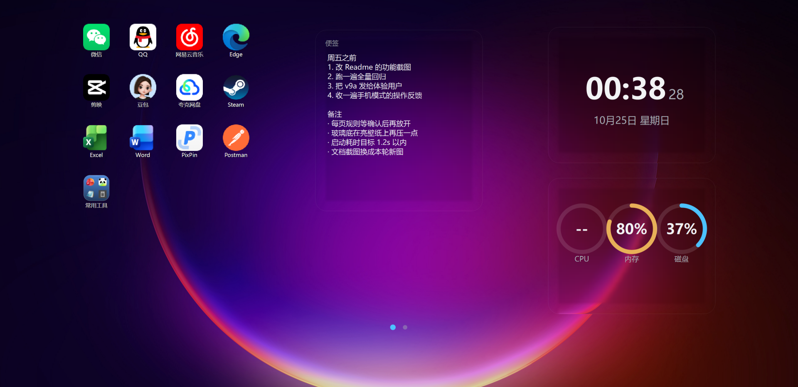
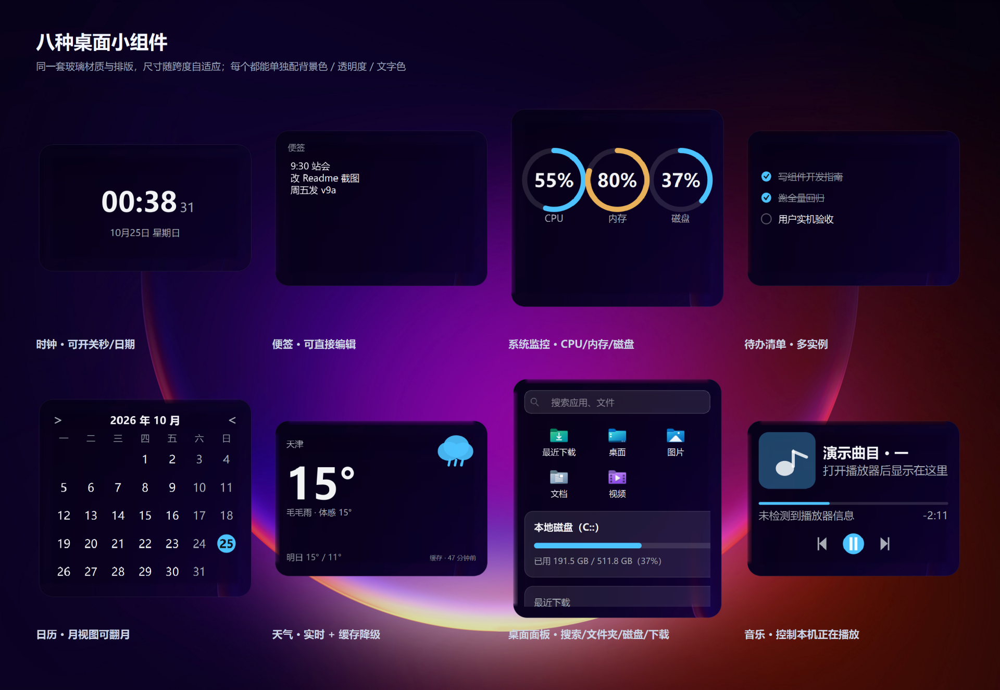
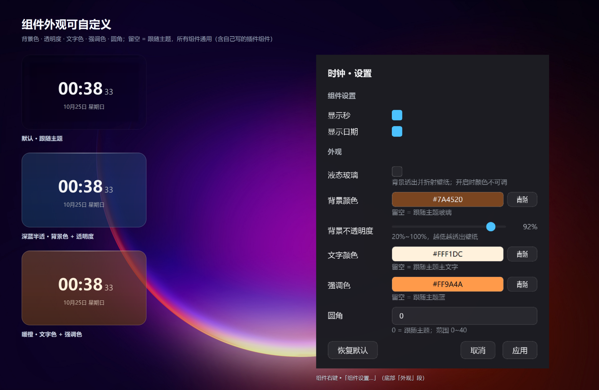
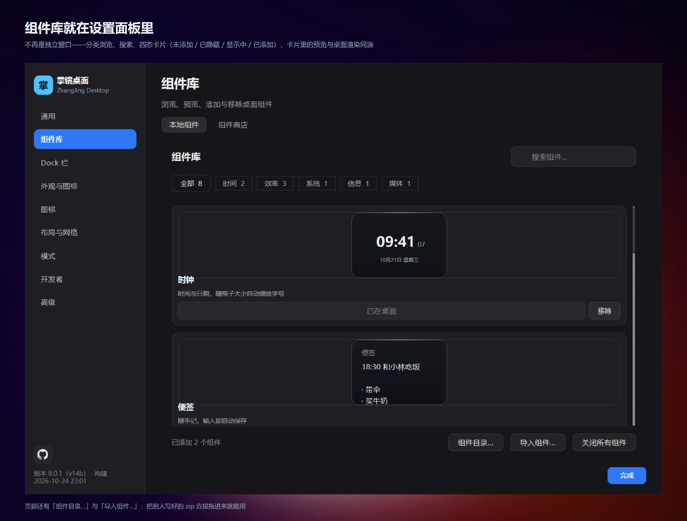
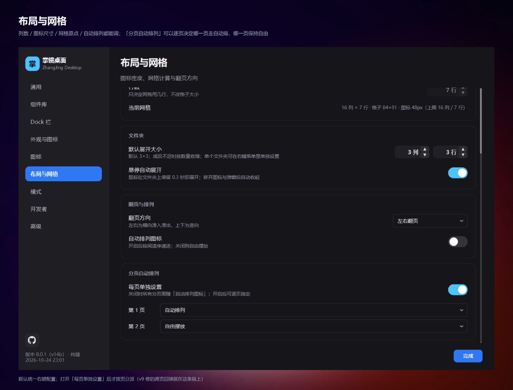
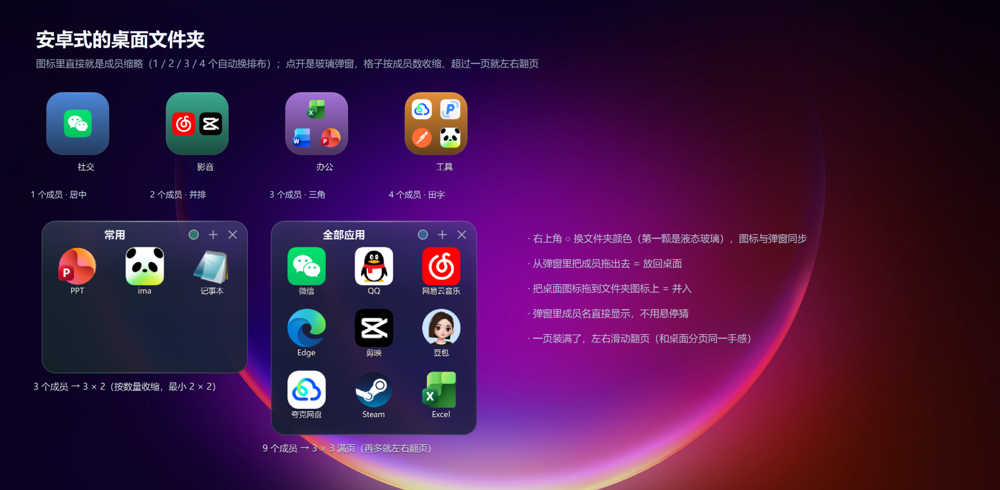
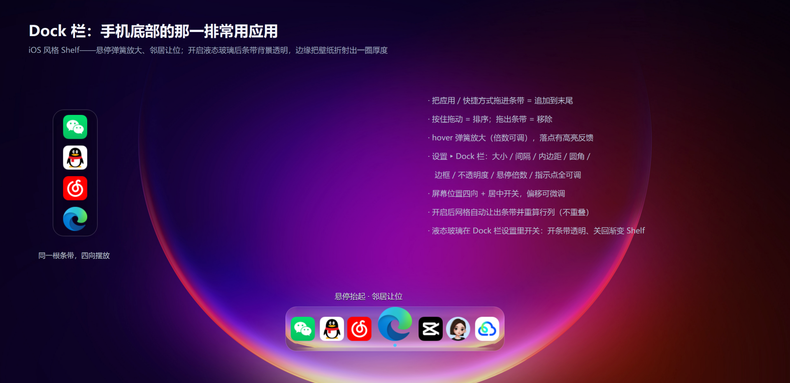

# 掌镜桌面

*一款把 Windows 桌面变成手机桌面的桌面美化工具——安卓式图标网格、弹簧动效与原生质感的小组件。*

[English](README_EN.md) | 简体中文

> 🚧 **项目处于活跃开发中**：当前已发版 **8.0.0（v14a）**，本版带来**液态玻璃**（文件夹 / Dock 栏 / 小组件背景可分别开关，设置 ▸ 外观）、**iOS 风格 Dock**（渐变 Shelf + 顶部高光 + 悬停抬起，成为新默认）、**天气组件分尺寸布局**（4×2 不是 2×2 的缩放：多出湿度 / 风力与三天温程条）、**图标文字样式设置**（颜色 / 阴影 / 描边，默认 1:1 还原 Windows 原生）与**移动预览框样式自定义**，以及**纯净模式**（桌面空白处双击隐藏全部 UI）、**文件夹悬停自动展开**、**默认空分页**（新手指引）等一批交互改进。**103 个测试文件全绿**。此前的 7.1.0 含新应用图标与安装向导美化、7.0.x 含安装器自动选语言与产品改名，6.x 含音乐组件真实播放、Dock 全自定义、新手引导、组件商店与英文界面。问题与想法欢迎 Issues。

[](https://github.com/a435630144/PhoneDesktopForWindow/releases)      [](LICENSE)

---

一款**界面语言与操作逻辑都走手机路线**的第三方桌面美化软件：它在桌面之上挂载一层自有网格，把原生图标替换为完全可控的渲染层——位置、动效、文件夹、小组件，全部由你定义。

开发深度上它**早已不是原型 Demo**：安装包 + 托盘常驻 + 崩溃日志 + 单实例 + 自动重挂守护，**103 个测试文件**。产品名 **掌镜桌面**（英文 ZhangJing Desktop；exe 名与数据目录保持 PhoneDesktop 不变，避免老用户数据路径失效）。

<p align="center"></p>

---

## ✨ 功能特性

| 模块 | 说明 |
|---|---|
| 🧭 图标网格 | 安卓式网格布局，列数/图标尺寸/DPI 全感知，单击选中、双击打开、拖动移动；**文件名两行显示**，不再截断 |
| 🤏 滑动让位 | 拖动图标时相邻图标弹性滑动让位（真弹簧物理曲线），落点精确到目标格，可取消滑回 |
| 📂 拖拽合并 | 图标拖到图标上悬停即合并成文件夹；**鼠标悬停文件夹即自动展开**（260ms 驻留，可关）；文件夹弹窗为液态玻璃材质 + 涌现开合动画，成员可拖出/移出 |
| 🖱️ 批量操作 | 橡皮筋框选 + 多选整体拖动 |
| 📋 桌面复制粘贴 | `Ctrl+C` / `Ctrl+V`：资源管理器里复制，点桌面直接粘贴落盘 |
| 🫥 纯净模式 | **桌面空白处双击 = 隐藏全部 UI**，只剩壁纸；再双击恢复 |
| 🧩 桌面小组件 | 时钟 / 便签（可编辑）/ 桌面面板（搜索 · 快捷文件夹 · 磁盘 · 最近下载 · 天气）/ **系统监控**（CPU · 内存 · 磁盘）/ **待办清单**（可多实例）/ **日历**（月视图，翻月记忆）/ **天气**（实时 + 缓存降级，**2×2 与 4×2 是两套布局**：4×2 多出湿度/风力与三天温程条）/ **音乐**（控制本机正在播放，不挑播放器，读专辑封面）；支持**锚定（非悬浮）**模式，融入网格成为一等公民，可拖拽缩放、与图标互相让位 |
| 🧩 组件库 | 设置面板里的独立分页：按分类浏览、搜索、四态卡片（未添加 / 已隐藏 / 显示中 / 已添加）与**实时预览**（预览与桌面渲染同一个 `draw()`）；支持导入 / 卸载第三方组件 zip，改了外观也能立即生效 |
| 🧊 液态玻璃 | 设置 ▸ 外观一个总开关 + 三个表面开关（文件夹弹窗 / Dock 栏 / 小组件背景）：元素背景保持**透明**，只有边缘一圈（默认 22px）把背后的壁纸**折射**出一道扭曲带——强度与带宽可调，0 即关闭 |
| 🔤 图标文字与预览框 | 设置 ▸ 图标独立分页：文字颜色 / 加粗 / 阴影（浓度可调）/ 描边（粗细 + 颜色），**默认 1:1 还原 Windows 原生**；拖动落点预览框的边框色 / 填充浓度 / 粗细 / 圆角也可自定义（内置红蓝绿橙预设） |
| 🔀 双模式 | **整理模式**（隐藏原生图标、接管桌面渲染）/ **原生模式**（无界自由摆放）：一键切换，两种布局**各自独立保存**，互不清空 |
| 📱 手机交互 | 设置 ▸ 模式 ▸ 交互方式：单击直接启动、按住 450ms 出菜单、按住后继续滑变成拖动；多选后图标左上角打钩，右键出批量菜单；空白处左右滑直接翻页 |
| 🚀 Dock 栏 | 底部一排应用快捷方式（可切顶部/左侧/右侧、可关闭），**iOS 风格 Shelf 为新默认**（竖向渐变 + 顶部高光 + 悬停弹簧抬起 + 邻居让位）；hover 放大、拖入追加、拖动排序、拖出移除；大小/间隔/内边距/圆角/边框/不透明度/悬停倍数/指示点全可调；开启后**网格自动让出条带并重算行列** |
| 📑 分页 | 图标溢出自动分页，**首次使用有一个空分页**（新手指引展示分页点）；页点 + 滚轮翻页，拖到屏幕边缘翻页；翻页是**整页轮播式平移**（图标与组件同一个弹簧标量，420ms 临界阻尼，无残留无错位） |
| 🧭 新手指引 | 首次启动 7 步引导：图标 → 拖动 → 文件夹 → 分页 → Dock → 小组件 → 收尾，聚光灯高亮真实界面元素；设置 ▸ 通用可随时重看 |
| 🔄 桌面同步 | 监听桌面目录增删改（1s debounce），新文件自动入场、删除项自动清理 |
| 🪄 全量接管 | 隐藏原生图标、按桌面文件夹克隆渲染，彻底掌控位置与样式（路线 A）；也可切回仅动效模式 |
| 🖥️ 自绘右键菜单 | 整理模式下桌面右键不丢失：新建文件夹/文本文档、重新扫描、图标大小、显示/个性化设置；「在文件夹中显示」按文件真实所在位置打开（快捷方式指原文件、桌面文件指桌面文件夹） |
| 🛡️ BandGuard 守护 | Win+D 显示桌面、explorer 崩溃重启后自动重挂 |
| ⏱️ 托盘常驻 | 暂停自动创建/恢复原生、重新扫描、面板开关、开机自启、设置 |

## 📸 界面一览

> 下面每一张都由 [`tools/shot_readme.py`](tools/shot_readme.py) 从**真实控件离屏渲染**生成（桌面上的应用图标取自 [`assets/demo_icons/`](assets/demo_icons/)，是各应用的商标，仅用于展示效果，由 [`tools/make_demo_icons.py`](tools/make_demo_icons.py) 导出）——桌面网格、玻璃组件、右键菜单走的是产品里同一份绘制代码，不是设计稿；两段动图由 [`tools/make_readme_anim.py`](tools/make_readme_anim.py) 用同一批素材逐帧录制（HTML 时间轴 + headless 截图 + Pillow 合成）。

**八种小组件**：时钟 / 便签 / 系统监控 / 待办清单 / 日历 / 天气 / 桌面面板 / 音乐，同一套玻璃材质与排版，尺寸跟着跨度自适应

<p align="center"></p>

**外观自定义**：同一个时钟三种皮肤。背景色、不透明度、文字色、强调色、圆角都能单独调，留空即跟随主题；字段对所有组件统一生效（包括自己写的插件组件）

<p align="center"></p>

**组件库**：已经长在设置面板里，四态卡片 + 实时预览；页脚的「导入组件…」可以直接吃别人打好的 zip，装完不用重启

<p align="center"></p>

**布局与分页**：列数、图标尺寸、网格原点、翻页方向都能调；「分页自动排列」可以逐页决定哪一页走自动排列、哪一页保持自由摆放

<p align="center"></p>

**手机习惯**：设置 ▸ 模式 ▸ 交互方式切过去之后，单击直接启动、按住 450 ms 出菜单、按住后继续滑就变成拖动；多选后图标左上角打钩，右键出批量菜单（合并为文件夹 / 移动到分页 / 删除选中）；空白处左右滑直接翻页

<p align="center"></p>

**安卓式文件夹**：图标里直接就是成员缩略（1 / 2 / 3 / 4 个自动换排布），点开是玻璃弹窗；格子按成员数收缩、超过一页就左右翻页，成员能拖出、也能把桌面图标拖进去

<p align="center"></p>

<p align="center"></p>

**安卓式分页**：图标溢出自动分页，左右滑动切换、页点跟着走；滚轮和拖到屏幕边缘也能翻页，每页还能各自决定走不走自动排列

<p align="center"></p>

**Dock 栏**：手机底部那一排常用应用。iOS 风格 Shelf——竖向渐变背板 + 顶部一道高光，悬停弹簧抬起、邻居让位；开启液态玻璃后条带改为**透明背景 + 边缘折射底图**（三个表面可分别在设置 ▸ 外观里开关）

<p align="center"></p>

## 🛠️ 技术栈与依赖版本

| 依赖 | 版本 | 用途 |
|---|---|---|
| Windows | 10 / 11（开发目标 Win11 @125% DPI） | 目标系统，x64 |
| Python | ≥ 3.12（开发用 3.13.12） | 运行时 |
| PySide6 | `>=6.6, <6.11`（开发锁定 6.10.3） | 唯一第三方运行时依赖 |
| PyInstaller | `>=6.0` | 打包便携版（仅构建需要） |
| Pillow | `>=10.0` | 图标生成工具（tools/make_icon.py） |
| Inno Setup | 6.7.3+ | 制作安装包（仅构建需要） |

- **纯 Win32 API** 桌面层挂载（`SetWindowPos` + `WorkerW`/`Progman` 桌面带、逐像素 alpha 命中测试、分层窗口穿透）
- **零 Qt Designer**：UI 全代码绘制，设计 tokens 集中在 `src/theme.py`
- 动效体系：`effects.spring_curve()` 自定义缓动（阻尼谐振子解析解），非 OutBack/OutCubic 近似

## 🚀 快速开始

### 环境要求

- Windows 10 / Windows 11（开发目标：Win11 @125% DPI）
- Python 3.12+（开发使用 3.13）

### 安装与运行

```powershell
git clone https://github.com/a435630144/PhoneDesktopForWindow.git
cd PhoneDesktopForWindow

# 安装依赖（仅 PySide6）
pip install -r requirements.txt

# 运行
python main.py
```

运行时数据在 `%APPDATA%\PhoneDesktop\state.json`（布局、设置、小组件显隐）。
自检：`python main.py --selftest`（启动 → 截图 → 退出，产出 `selftest_report.txt`；打包后的 exe 同样支持 `--selftest`）。

> ⚠️ **首次使用建议**：先在托盘图标右键熟悉「暂停自动创建/恢复原生」入口——整理模式会接管桌面图标显示，随时可一键恢复原生桌面。

## 📁 项目结构

```
PhoneDesktopForWindow/
├── main.py                  # 入口：崩溃钩子 → 单实例 → 托盘 → 主窗口 → BandGuard
├── requirements.txt         # PySide6==6.10.*
├── assets/                  # 应用图标
├── docs/                    # 面向用户的文档
│   ├── 组件开发指南.md        # 外部开发者写插件组件的 SDK 文档
│   ├── release_notes/        # 各版本发布说明
│   └── images/               # README 配图（脚本生成）
├── src/
│   ├── 核心机制 ★
│   │   ├── win32_layer.py    # 桌面层挂载 + 原生图标隐藏/恢复 + z-order 工具
│   │   ├── band_guard.py     # Win+D / explorer 重启守护
│   │   ├── desktop_window.py # 主窗口：网格/拖拽/框选/文件夹/原生图标同步
│   │   └── iconwidget.py     # 图标部件：多属性弹簧动效 + 拖动 payload 协议
│   ├── 纯逻辑（零 Qt 依赖，可单测）
│   │   ├── grid_flow.py      # 让位引擎（reflow_moves / displace_cells）
│   │   ├── grid_metrics.py   # 网格度量（origin / cols / rows）
│   │   ├── grid_sizing.py    # cell 尺寸与图标档位（v7 改造中）
│   │   ├── drag_merge.py     # 合并 / 挤走几何判定
│   │   └── widget_catalog.py # 组件跨度目录
│   ├── UI 部件
│   │   ├── folder_popup.py / folder_tint.py    # 文件夹弹窗与图标底色
│   │   ├── widget_base.py / widget_layer.py    # 组件基类与注册
│   │   ├── dock.py             # Dock 栏（纯函数 inset/hit_index + DockWindow）
│   │   └── widgets/           # 内置组件一组件一目录（clock/notes/panel/monitor/todo/calendar/weather/music）
│   └── 基础设施
│       ├── storage.py / paths.py / version.py
│       ├── media_session.py    # 播放会话抽象（媒体键 + 演示态降级）
│       ├── appsource.py / desktop_watch.py / shell_new.py
│       ├── effects.py / theme.py
│       └── settings_dialog.py / add_apps_dialog.py / tray.py / autostart.py
│           / single_instance.py / selftest.py
├── scripts/
│   ├── build_portable.ps1   # PyInstaller onedir → zip（需 pwsh 7）
│   ├── installer.iss        # Inno Setup 6 安装包（必须 UTF-8 BOM）
│   └── check_docs.py        # 文档一致性自检（死链/重复章节/文档与代码数值漂移）
├── tests/                   # 103 个独立可跑脚本（无 pytest），判据看退出码
│   ├── smoke_test.py        # 无头逻辑回归（存储/克隆/布局）
│   └── test_*.py            # 每条契约一份：让位引擎、双模式、命中、弹窗、组件…
└── tools/                   # 运行态探针 probe*.py + 打包验证 verify_*.py
```

## 🧪 测试

```powershell
# 无头逻辑回归
python tests/smoke_test.py

# 全量单测：103 个独立脚本，无 pytest；判据只看退出码
Get-ChildItem tests/test_*.py | ForEach-Object {
    python $_.FullName
    if ($LASTEXITCODE -ne 0) { "FAILED: $($_.Name)" }
}
```

> 每个测试脚本自带 `check()` + 汇总 + 退出码。**输出文案各文件不统一**（`ALL PASSED` / `ALL xxx PASSED` / `ALL PASS`），所以别用 grep 固定文案判通过——曾经因此把 41 个全绿文件误报成失败。

`tools/` 下另有运行态探针（probe5–probe23：动效可视化、让位精度、接管模式、层序、鼠标命中）与打包版验证（`verify_frozen.py` / `verify_live.py`）。**探针安全铁律：只读枚举用户窗口、绝不移动/关闭任何用户窗口**。

## 📦 打包

```powershell
# 便携版（PyInstaller onedir + zip）
pwsh -File scripts/build_portable.ps1

# 安装版（Inno Setup 6，含安装向导/桌面快捷方式/卸载入口）
& "$env:LOCALAPPDATA\Programs\Inno Setup 6\ISCC.exe" scripts/installer.iss
```

> ⚠️ PyInstaller 产物可能被 Windows Defender / 第三方杀软**误报**，需加白名单或代码签名；分发时优先用安装包形态。

## 📚 文档索引

| 文档 | 内容 |
|---|---|
| [docs/组件开发指南.md](docs/组件开发指南.md) | **组件插件开发指南**：不碰主程序代码就能做出可安装、可配置的桌面小组件 |
| [docs/release_notes/](docs/release_notes/) | 各版本发布说明 |
| [docs/images/](docs/images/) | README 配图（由 `tools/shot_readme.py` 等脚本从真实控件渲染生成） |

> 开发过程文档（开发日志、迭代规格与实施计划、反馈研判）只在本地维护，不进仓库。

## 📜 更新日志

> 按**安装包版本号**倒序；括号内是内部迭代标签（见 `src/version.py`，界面右键菜单底部可看构建时刻）。更多细节见 [`docs/release_notes/`](docs/release_notes/)。

### 8.0.0（v14a）· 液态玻璃 · iOS 风格 Dock · 组件分尺寸布局 → [发布说明](docs/release_notes/8.0.0.md)

- **液态玻璃**（反馈 9）：设置 ▸ 外观总开关 + 三个表面开关（文件夹弹窗 / Dock 栏 / 小组件背景）；透镜边缘 fresnel 反光、色散镶边、材质颗粒、缓慢扫光，强度各自可调；系统关闭动画时扫光自动停
- **Dock iOS 风格**（反馈 5）：渐变 Shelf + 顶部 specular 高光 + 悬停抬起成为新默认；图标 44px / 圆角 20 / 悬停 1.40×
- **天气组件分尺寸布局**（反馈 7）：4×2 不是 2×2 的缩放——左块多出湿度 / 风力，右栏三天预报带全局温程归一的温程条
- **图标文字样式 + 预览框样式**（反馈 3 / 13）：设置 ▸ 图标独立分页；默认 1:1 还原 Windows 原生
- **纯净模式**（反馈 11）：桌面空白处双击隐藏全部 UI，再双击恢复
- **文件夹悬停自动展开**（反馈 1）/ **默认空分页**（反馈 4）/ **右键在文件夹中显示三态路径**（反馈 6）/ **添加应用 sheet 疏排**（反馈 8）/ **图标文件名两行**（反馈 12）/ **组件商店安装位置指向程序目录**（反馈 14）/ 鼠标速度异常排查（反馈 2）

### 7.1.0（v13a）· 新图标 · 安装向导美化 · 界面中英分语种统一 → [发布说明](docs/release_notes/7.1.0.md)
### 7.0.2（v12c）· 安装器按系统环境自动选择语言 → [发布说明](docs/release_notes/7.0.2.md)
### 7.0.1（v12b）· 产品名称统一为掌镜桌面 → [发布说明](docs/release_notes/7.0.1.md)

### 7.0.0（v12a）· 设置面板修复 · Dock 四向内边距与位置 · 监控组件 2x1 → [发布说明](docs/release_notes/7.0.0.md)

### 6.2.0（v11c）· 音乐组件抓封面 · 没进度就不画进度条 → [发布说明](docs/release_notes/6.2.0.md)

- **音乐组件显示专辑封面**：读 SMTC 的 `MediaProperties.Thumbnail`，按内容哈希缓存到 `%APPDATA%/PhoneDesktop/media_cover_*.img`，圆角居中裁切绘制；换歌才重新读盘，缓存只留最近 6 张
- **拿不到时长就整条进度条不画**：窗口标题档 / 播放器不报 timeline 时，不再留一条空底轨（以前那条压暗的底轨看起来像"卡在 0"）；按键行随之上移
- 实测说明：PowerShell 5.1 读不了 WinRT 图片流（`OpenReadAsync` 返回裸 `__ComObject`），改用 `RandomAccessStream.CopyAsync` + `InMemoryRandomAccessStream` 绕行，**字节级校验一致**（`src/media_cover.ps1`）

### 6.1.0（v11b）· 首次启动新手操作指引 → [发布说明](docs/release_notes/6.1.0.md)

- **首次安装启动自动进入 7 步引导**：欢迎 → 图标（双击 / 拖动 / 多选）→ 拖成文件夹 → 分页 → Dock → 小组件 → 收尾，聚光灯高亮真实界面元素，不是示意图
- 单击遮罩 / `→` / 空格 = 下一步，`←` = 上一步，`Esc` = 跳过；`跳过` 也算看过，不会每次启动重复打扰
- 分页 / Dock / 小组件三步**按实际内容动态出现**（没开 Dock 就不讲 Dock）；以后加步骤只需把 `ONBOARDING_VERSION` +1，老用户只补看新增内容
- **设置 ▸ 通用 →「查看新手指引」** 可随时重看；同页新增桌面快捷键说明（`Ctrl+C` / `Ctrl+V`）
- 顺带：旧的首次运行托盘气泡下线（文案还写着"系统桌面保持原生"，与默认的整理模式相反）

### 6.0.0（v11a）· Dock 尺寸自定义 · 音乐组件读真实播放 · 开发者分页 · 桌面复制粘贴 → [发布说明](docs/release_notes/6.0.0.md)

- **Dock 栏更多自定义**：图标大小 / 图标间隔 / 条带内边距 / 悬停放大倍数四项独立可调（改尺寸走轻量重排，拖步进器不再重建全部图标）
- **音乐组件读当前音频**：SMTC 侧车读到真实曲名、艺人、播放状态、进度与时长；进度条可**拖动 seek**；播放器不发布 SMTC 时退到窗口标题档（显示 `歌名 - 歌手` 并注明「仅曲名」），三档自动降级
- **开发者选项独立分页**：顶部总开关，关闭时下列整组不可交互；网格线 / 组件碰撞体积 / 帧率读数 / 组件窗口巡检各自一个开关，网格原点定位一并搬入
- **桌面 Ctrl+C / Ctrl+V**：低层键盘钩子，只在前台是桌面、且确实有东西可复制/可粘贴时接管（资源管理器复制 → 点桌面 → Ctrl+V 直接落盘）
- **更新检测 + 关于作者**：高级页从 GitHub 最新 Release 比对版本号（后台线程，不冻界面），可直接跳下载页；新增作者介绍与抖音 / 哔哩哔哩入口
- **侧栏 GitHub 图标**：设置面板左下角一键进仓库
- 顺带修掉：Dock 位置下拉显示英文、「高级」页副标题过期

### 5.0.6（v10g）· 组件左侧盲区真因 · 命中坐标空间

- **盲区真因**：`close()` 的淡出被打断就永不销毁，留下 alpha=0 却仍吃点击的「透明命中壳」；改成立即销毁 + 400 ms 兜底 + 孤儿清扫，自检输出 `widget_orphans`
- `WM_NCHITTEST` 的 lParam 是物理像素、Qt 几何是逻辑坐标，统一过 `devicePixelRatioF()` 换算（高缩放下左侧放行区只覆盖一半）
- Dock 拖入指示器崩溃（`QPointF` 未导入）

### 5.0.5（v10f）· 松手回漂真因 · 组件商店 404

- 组件松手回漂：`anchorDrop` 早于 `_snap_to_grid()` 发出，回调里还是旧格；改为松手只回数据、落定后按最终 entry 一次让位
- 组件商店下载 404：`package` 只写文件名而 zip 在 `dist/`，客户端多候选路径兜底

### 5.0.4（v10e）· Dock 设置卡顿/崩溃 · 边框可调

- Dock 外观滑条不再每像素全量重排（`refresh_band` + 重建图标）→ 只重绘 + 250 ms 去抖落盘；崩溃随之消失
- 新增边框粗细（0~4）与颜色（可跟随主题）
- 组件碰撞体积红底 + 卡片/真实窗口双框，把「没有红底却点不动」的盲区可视化

### 5.0.3（v10d）· 组件碰撞可视化 · Dock 收快捷方式 · 监控 4×2 重构

- 调试模式给组件碰撞体积铺半透明红底；Dock 准入改按「能否启动」判定（`.lnk/.url/.exe…` 收，文档与目录拒）
- 系统监控 4×2 宽版重构（标签 / 大数字 / 进度条 / 副行三列等分，窄于 130px 省略副行）

### 5.0.2（v10c）· 分页点不被 Dock 遮挡 · 拖入反馈

- Dock 启用时分页点被压住不显示（页点 y 扣除 dock inset）
- Dock `dragEnter` 对非本程序拖拽明确拒绝；组件松手不再回漂

### 5.0.1（v10b）· 修复界面语言不生效 · 组件库响应式 → [发布说明](docs/release_notes/5.0.1.md)

- **修复中英混搭**：v10a（5.0.0）的包漏打包语言词表，查词落空后界面大量文案直接显示 `settings.title` 这类内部 key；本版词表进包，并补「冻结态取词 + 打包契约」两条回归判据，自检报告输出词表规模与抽样译文
- **组件库响应式布局**：放得下 2 列才 2 列——窄窗自动 1 列并加宽卡片、够宽才双列，横向滚动条取消；本地组件与商店同一套规则，设置窗最小宽放开到 600

### 5.0.0（v10a）· 组件商店 · 英文界面 · 安装器双语言 · 改名 PhoneDesktop → [发布说明](docs/release_notes/5.0.0.md)

- **组件商店**：app 不再内置全部组件，按需下载——gitee 优先、github / jsDelivr 兜底，每个包 sha256 校验，坏包装不上也拖不垮启动；设置 ▸ 组件库拆「本地组件 / 组件商店」双页签；首批上架**世界时钟**、**倒计时**；内置 8 个种子组件断网可用，商店永不覆盖内置组件
- **英文界面**：设置 ▸ 通用「界面语言」自动 / 中文 / English，切换即时生效；覆盖设置六页、托盘菜单与气泡、桌面右键菜单、组件库、组件设置弹窗与版本串
- **安装器双语言 + 美化**：中文向导（自维护覆盖层）+ 英文对照，120% 向导、安装包图标与产品图
- **改名 PhoneDesktop**：exe 名 / 安装目录 / `%APPDATA%` 数据目录一起改，老用户数据首次启动**一次性自动迁移**，布局与设置不丢
- **9 条实机反馈**：组件交互盲区 / Dock 拖入应用 + 独立设置分页（图标大小 / 圆角 / 不透明度 / 悬停放大 / 指示点）/ 设置里切换 Dock 位置不生效 / 新组件默认网格模式 / 右键改名分「网格 / 无界」/ 删掉无用的「恢复组件」按钮 / 组件**填充百分比**（默认不填满，并排不再贴边）/ 尺寸调节虚线压卡片边缘、定位球同步外偏 / 桌面面板重构（编辑配色生效、天气冲突解除）/ **Dock 默认圆角收小为 12px**（0~26 可调，超过半厚自动夹紧）

### 4.0.0（v9a）· 全组件外观自定义 · 组件插件平台 · 手机式双交互 → [发布说明](docs/release_notes/4.0.0.md)

- **全组件外观自定义**：背景色 / 不透明度 / 文字色 / 强调色 / 圆角，注册时统一注入、组件零改动；组件库预览与桌面渲染同一个 `draw()`
- **组件插件平台**：写一个目录或 zip 就能装进桌面（[组件开发指南](docs/组件开发指南.md)）；`widget_plugin` 校验 manifest、防 zip-slip、命名空间隔离；预览调试器 + 打包脚本 + 组件库一键导入
- **组件库并入设置面板**：独立窗口“被压住 + 点不动”从结构上消失；每页独立排序规则，跨页拖动不再回弹
- **手机式双交互**：单击启动 / 长按 450ms 菜单 / 长按后滑动转拖动 / 多选批量（合并文件夹 / 移动分页 / 删除）/ 空白滑动翻页
- 时钟便签玻璃化重写；组件「隐藏」「关闭」合并为「关闭」

### 3.0.0（v8a）· 组件库 + 四个新组件

- 组件注册表 `WidgetSpec` 单点声明（跨度 / 分类 / 形态 / 设置 / 预览）；玻璃卡片基类（静态玻璃，不做实时模糊）
- **系统监控**（CPU · 内存 · 磁盘）/ **待办清单**（多实例）/ **日历**（月视图，翻月记忆）/ **天气**（Open-Meteo，实时 → 缓存 → 空三级降级）
- 组件设置弹窗 `FieldSpec` 声明式表单；独立组件库窗口（分类 + 搜索 + 四态卡片 + 实时预览，预览与桌面复用同一个 `draw()`）

### 2.1.3（v7e）· 8 条反馈 + 视觉批次

- 推让 / 提示节拍两头提前（450/700→350/470，翻页 600→360）；无界松手不回弹；组件右键菜单随模式；无界→网格组件坐标回算
- 自动排列真正密排；弹窗图标 40–56 与绘制单点；编辑控制点改圆球 + ≥22px 命中区；仅小组件模式归还原生桌面；脏区重绘守 60fps（`frame_stats` 可读）

### 2.1.2（v7d）· 10 条反馈

- 滑条断触防抖 / 行列 Stepper 自绘步进器 / 文件夹满页分页 / 3×3 弹窗两级居中 / 组件 span 碰撞 / 文件夹内拖出碰撞预览 / 入夹双区判定 / 边缘悬停翻页 / 仅小组件模式 / 单图标自动解散文件夹

### 2.1.1（v7c）· 4 条反馈

- 文件夹「添加应用 / 换颜色」改独立表单（16 预设 + 自动 + 自定义，换色不再重建成员）/ 组件手动改尺寸后碰撞形状同步（含四角双向步进）/ 图标默认「中」双源合并 / 网格调试信息移入设置面板

### 2.1.0（v7b）· v7a 实机 17 项反馈全部闭环

- 双布局并存（网格与无界各自保存，切换零换算零清空，`icon_px` 退役）/ 拖拽连锁避让进动画清单（布局为唯一真相）/ 组件矩形领地内不再吞点击（`alpha=2` 全窗填充 + `WM_NCHITTEST`→`HTCLIENT`）
- 下拉浮层实心 / 文件夹文件名 + 尺寸 + 右上角三入口 / 单图标尺寸 + 管理区 / 启动即接管 + 小组件模式

### 2.0.0（v7a）· 尺寸两层模型

- `cell_from_native` 由原生图标推导格子、`solve_dims` 统一求解；档位只改格内占比（`icon_fit`），行数 = 纯裁剪
- 网格原点可手动定位

### 1.7.0（v6g）· 实机问题修复

- Win+D 后接管桌面消失 / 拖组件预览叠格 / 合并提示被挤走 / 文件夹弹窗跑远；顺带修 `app: null` 崩溃，崩溃日志前移

### 1.6.0（v6c–v6f）· 五轮实机反馈

- 桌面带层号体系 / 注册表反解读图 / 八点缩放 / 玻璃背景真根因等共 28 条反馈修复

### 1.4.0（v6）· 双模式与桌面同步

- 双模式（整理 / 原生，一键切换）/ 组件入网格 / 弹窗覆盖性 / 箭头徽标 + 设置项合并 / 设置界面重设计 + 桌面目录自动同步 / 壁纸保留 / Win+D 与 explorer 重启守护

### 1.3.0（v5）· 网格自适应

- GridMetrics 自适应 / `reflow_moves` 位移清单 / 组件跨度化 / 文件夹弹窗重做 / 分页

## ⚠️ 已知限制

- 多显示器：本期仅主屏
- 跨页拖动：受当前页容量限制，需先翻页
- 第三方动态壁纸（如 Wallpaper Engine）：未专门适配
- 杀软误报：见上文打包说明

## 📄 许可证

本项目基于 **[GPL-3.0](LICENSE)** 许可证开源：任何基于本项目的衍生作品必须同样以 GPL-3.0 开源，防止闭源套壳。

## ❤️ 赞助作者

如果这个项目对你有帮助，欢迎请作者喝杯奶茶～

<p align="center"></p>

<p align="center">支付宝扫一扫 · 谢谢支持</p>
